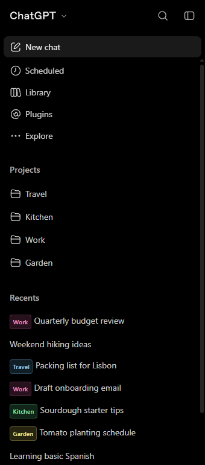

# ChatGPT project badges

A userscript that shows which project each ChatGPT conversation belongs to, right in the chat list.

ChatGPT's Recents list mixes project chats in with everything else, and search results do the same, with nothing to say which project a chat came from. This adds a small coloured pill in front of each project chat's title: in Recents, in the search dialog, and anywhere else a chat is linked.

Each project gets its own colour, derived from a hash of its name, so the same project always looks the same. If a project has an emoji set, the badge shows it too.

This is the ChatGPT counterpart of [Claude project badges](https://github.com/PrimEZP/Claude-UI).

## Install

1. Install [Violentmonkey](https://violentmonkey.github.io/) or [Tampermonkey](https://www.tampermonkey.net/).
2. In Chrome, open `chrome://extensions`, click **Details** on the extension, and turn on **Allow User Scripts**. Nothing will run without this. Older builds need **Developer mode** switched on first. Firefox doesn't need either.
3. Open [the raw script](https://github.com/PrimEZP/ChatGPT-UI/raw/main/chatgpt-project-badges.user.js). The extension recognises the `.user.js` file and offers to install it.
4. Click **Install**, then reload chatgpt.com.

Installed this way, the extension checks this repo for new versions and updates the script on its own.

If the install prompt doesn't appear, create a new script in the extension and paste in the contents of [`chatgpt-project-badges.user.js`](chatgpt-project-badges.user.js) instead. A pasted copy won't update itself.

## Where badges appear

| Place | Badged? |
| --- | --- |
| Recents in the sidebar | Yes |
| Search dialog results | Yes |
| A project expanded in the sidebar | No: every chat there is from that project |
| A project's own page | No, for the same reason |

Set `hideOnOwnProject: false` to badge the last two as well.

## How it works

On load the script asks chatgpt.com for your projects and for the chats in each one, using your existing session. That gives it a map from conversation ID to project.

- Project chats in Recents link to `/g/g-p-<project id>/c/<chat id>`, so the project is read straight from the link. A chat you've just made in a project gets its badge immediately, without waiting for the next refresh.
- Search results link every chat as a plain `/c/<chat id>`, with no project in the link. Those are looked up in the map.
- Sidebar titles sit inside a marquee that scrolls long titles on hover. The badge goes beside the marquee, so it stays put while the title scrolls.
- Search results highlight the matched words in the title. The badge goes at the start of the title line, never inside a highlight.
- The app re-renders rows and discards the injected badge, so the script checks whether the badge is still there rather than remembering that it added one.

A `MutationObserver` watches the page and labels links as the app renders them. It ignores the changes the script makes itself, so adding a badge doesn't set off another repaint.

Nothing is sent anywhere. All requests go to chatgpt.com, same as the page itself.

## Configuration

Options live in the `CFG` block at the top of the script.

| Option | Default | What it does |
| --- | --- | --- |
| `showUnfiled` | `false` | Also badge chats with no project, with a grey "no project" pill |
| `hideOnOwnProject` | `true` | Skip badges in a list that's already about that project |
| `refreshMs` | `300000` | How often to re-pull projects and their chats, in ms |
| `maxPagesPerProject` | `25` | Cap on pages fetched per project |
| `concurrency` | `4` | How many projects are fetched at once |
| `missGraceMs` | `20000` | Minimum gap between refetches when an unrecognised project appears |
| `debug` | `false` | Show the diagnostic panel described below |

## When badges stop appearing

ChatGPT's markup and API shapes change from time to time. Set `debug: true`, save, and reload. A panel appears in the bottom right showing how many chat links were found, how many were badged, how many were skipped, how many had no usable title, plus the tag and class chain of one row.

- `projects: 0` means the API call failed or its response shape changed. Check the `error` line.
- `links` high but `badged: 0` means the page markup changed and the title lookup needs updating.
- `noTitle` high means rows are structured differently than the script expects.

The panel is readable without devtools, which are locked down in some managed browsers.

## Limitations

- A chat moved into a project only gets its badge in search results after the next refresh, up to 5 minutes later. Recents picks it up as soon as the link changes.
- Projects in a Team or Enterprise workspace should work, since the script sends the workspace ID the way the app does, but this has only been tested on a personal account.
- Project colours come from a name hash, so two projects can land on similar hues. Rename one, or set an explicit hue in `hashHue()`.
- Relies on undocumented internal endpoints. It can break after any ChatGPT update.

## License

MIT. Not affiliated with, endorsed by, or supported by OpenAI.
